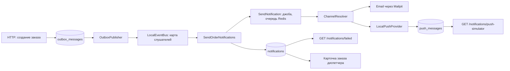
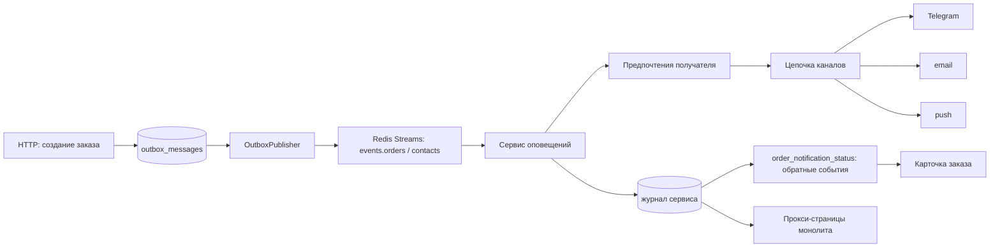
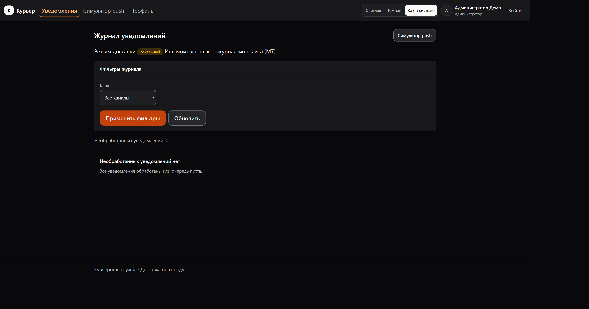
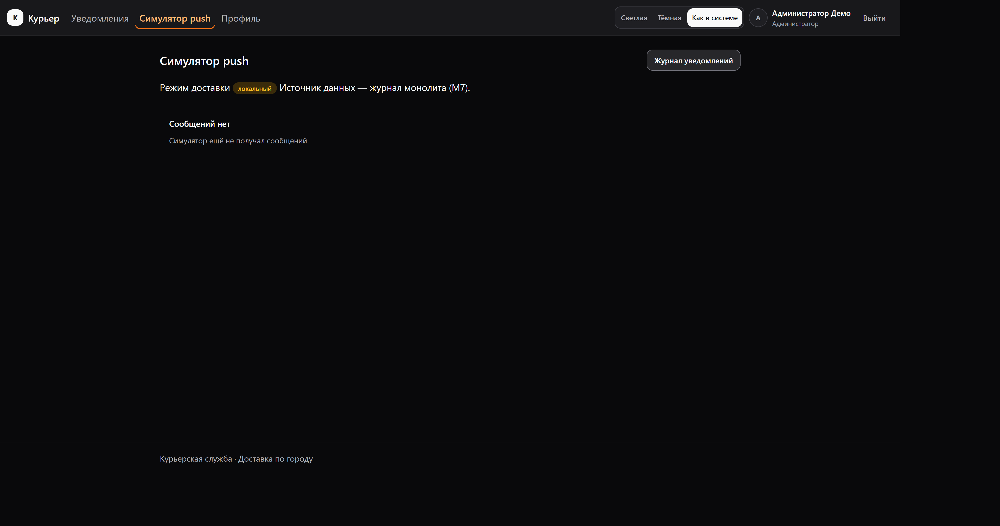
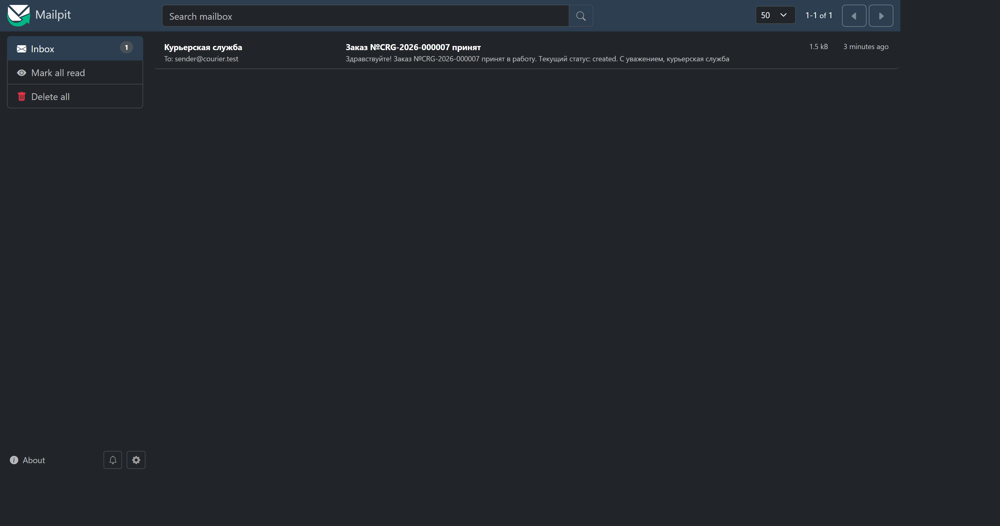
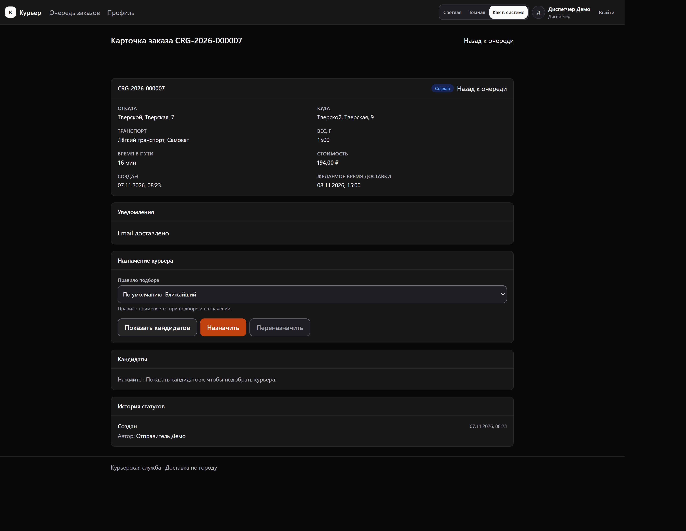

# До и после — переходный период уведомлений (M11 → M12)

Артефакт снят **07.11.2026** (08:20–08:27 MSK) до удаления переходного периода M11, пока локальный путь M7 ещё выполнялся. Срез нужен, чтобы после удаления было видно, как работала доставка до M12: схемы потока, цитаты прежнего кода, снимки экранов администратора и локального журнала.

Требования, по которым снят артефакт: [ЧТЗ - Telegram и предпочтения](<../Техническое задание/Telegram и предпочтения/ЧТЗ - Telegram и предпочтения.md>), FR-NTF-401…409, разделы 7.2, 10, 11; порядок шагов — План - Telegram и предпочтения (M12) (не публикуется), разделы 7–8 (шаги 1–6, гейты G0/G1).

Снимки сняты в демонстрационном окружении (`APP_ENV=local`, `http://localhost:8080`, Mailpit `http://localhost:8025`) под учётными записями из `database/seeders`: администратор `admin@courier.test`, диспетчер `dispatcher@courier.test`, пароль `password` (значение `config/demo.php`).

## 1. Зачем этап

До M12 в монолите одновременно существовали два отправителя уведомлений: локальный путь M7 и сервис оповещений. Режим выбирался переменной `NOTIFICATIONS_DRIVER` и enum `DeliveryMode`, поэтому:

- один и тот же заказ мог получить уведомление дважды, если режим переключали на ходу;
- новый функционал этапа M12 (Telegram, предпочтения, цепочка каналов, тихие часы) рисковал «прирасти» к мёртвой ветке;
- журнал, попытки и матрица каналов дублировались в двух местах — в базе монолита и в базе сервиса.

Поэтому первый шаг этапа — удаление переходного периода (FR-NTF-401…409), а этот артефакт фиксирует «как было» до удаления: после него старый код доступен только в архивном срезе `archive/fr-ntf-300-legacy-driver` (FR-NTF-409, срез создаёт пользователь).

## 2. Как было

Поток локального пути M7 (режим `local`, значение по умолчанию):



То же словами, без диаграммы:

1. Создание заказа пишет строку в `outbox_messages` в той же транзакции, что и заказ.
2. `OutboxPublisher` читает Outbox. В режиме `local` он брал `LocalEventBus` — карту «тип события → слушатели» внутри процесса, — и событие не уходило в поток сервиса.
3. Слушатель `App\Listeners\SendOrderNotifications` по матрице из `config/notifications.php` создавал строки `notifications` (получатель, канал, статус, шаблон) и после COMMIT ставил джобу.
4. Джоба `App\Jobs\SendNotification` (`tries`, `timeout` и `backoff` из конфигурации) вела строку журнала по состояниям и писала попытки в `notification_attempts`.
5. `ChannelResolver` отправлял письмо через `App\Mail\NotificationMail` в Mailpit либо push через `PushProvider`, реализованный `LocalPushProvider`: сообщение записывалось в `push_messages`.
6. Администратор видел локальный журнал на `/notifications/failed` и `/notifications/push-simulator` с индикатором активного режима; повтор выполняли кнопка на странице, команды `notifications:failed` / `notifications:retry`.
7. Диспетчер видел статус доставки в карточке заказа: в режиме `local` он читался из `notifications` по событию Outbox, в режиме `service` — из проекции `order_notification_status`.
8. Сроки хранения соблюдала команда `notifications:purge`, удалявшая `notifications`, `notification_attempts` и `push_messages`.

## 3. Как стало

Целевое состояние M12 (часть появится по ходу этапа — предпочтения, Telegram, цепочка каналов и тихие часы это пункты 3–10 плана):



Словами:

1. Монолит только публикует события в Outbox и транспорт `events.transport`; шина одна, режима уведомлений в монолите больше нет.
2. Сервис оповещений — единственный отправитель: он хранит журнал, попытки, матрицу и предпочтения, выбирает каналы и решает, куда и когда отправлять.
3. Канал Telegram добавляется третьим; порядок каналов задаёт предпочтение получателя, недоступный канал заменяется следующим, некритичное сообщение в мессенджер в тихие часы откладывается.
4. Монолит узнаёт статус доставки из обратных событий (`order_notification_status`) и из служебного API сервиса; страницы `/notifications/failed` и `/notifications/push-simulator` работают как прокси и подписывают источник «сервис оповещений».
5. Требования, матрица каналов, попытки и сроки хранения существуют только в конфигурации сервиса.

## 4. Что удалено и чем заменено

| Удалено (M11, локальный путь) | Чем заменено (M12) |
|---|---|
| Переменная `NOTIFICATIONS_DRIVER` в `courier/.env.example` и `docker-compose.yml`, ключ `driver` в `config/notifications.php` | Ничем: режима нет, единственный отправитель — сервис оповещений (FR-NTF-401, FR-NTF-403) |
| Enum `App\Services\Notifications\DeliveryMode` | Ничем: ветвление по режиму исчезает вместе с ним |
| Слушатель `App\Listeners\SendOrderNotifications` | Обработчик события в сервисе (`Services/Events/OrderEventProcessor`) с предпочтениями получателя |
| Джоба `App\Jobs\SendNotification` | Отправка сервиса (`Services/Notifications/NotificationSendQueue` + `ChannelSender`) |
| `App\Services\Notifications\ChannelResolver` | `ChannelSender` сервиса с ветками email, push и (M12) Telegram |
| `LocalPushProvider`, `PushProvider`, `PushProviderFactory` монолита | `Channels/PushProviderFactory` сервиса (`FakePushProvider`, реальный провайдер — M13) |
| `NotificationFailureQueue` (очередь необработанных) | `NotificationSendQueue::due()` сервиса и API журнала |
| `AttemptMessageSanitizer` монолита | Санитайзер сервиса (`services/notifications/app/Services/Notifications/AttemptMessageSanitizer.php`) |
| `NotificationPolicyFactory` и ключи `enabled_channels`, `policy`, `requires_assignment` в конфигурации монолита | `NotificationPolicyResolver` и конфигурация сервиса; в M12 — предпочтения пользователя |
| `NotificationMessageContext` (восстановление текста при повторе) | Данные строки журнала сервиса; повтор выполняет API сервиса |
| Ключи `max_attempts`, `backoff_seconds`, `job_timeout_seconds`, `attempt_message_limit`, `retention_days`, `attempt_retention_days`, `push_retention_days`, `push_provider` в конфигурации монолита | Одноимённые настройки конфигурации сервиса |
| Локальные таблицы `notifications`, `notification_attempts`, `push_messages` | Журнал и попытки в базе сервиса `notifications` |
| Модели `App\Models\Notifications\{Notification,NotificationAttempt,PushMessage}` и их фабрики | Модели сервиса (`Models/Notification`, `NotificationAttempt`, `PushMessage`) |
| Команды `notifications:failed`, `notifications:retry` | API сервиса (`GET /api/v1/notifications`, `POST /api/v1/notifications/{id}/retry`) и прокси-маршруты монолита |
| Локальная очистка журнала `notifications:purge` и её запись в расписании | `PurgeNotifications` сервиса по своему расписанию |
| Индикатор активного режима `<x-app.delivery-mode>` на админ-страницах | Подпись «сервис оповещений» без переключателя (FR-NTF-405) |
| Выбор источника в `NotificationAdminJournal` по `config('notifications.driver')` | Единственный источник — `NotificationServiceClient` |
| Чтение локального журнала в карточке заказа (`Livewire\Dispatcher\OrderCard`) | Только проекция `order_notification_status` из обратных событий |
| Доменные `NotificationPolicy`, `NotificationRule`, `RecipientRole`, `NotificationTemplate`, `NotificationTransitions`, `NotificationFailureCode`, исключения уведомлений и `App\Mail\NotificationMail` | Домен и письма сервиса; в монолите остаются только `NotificationChannel` и `NotificationStatus` для подписей админ-страниц |
| Тексты шаблонов `lang/ru/notifications.php` (`templates`) и ключи `notifications.driver` | Тексты сервиса (`lang/*/notifications.php` сервиса); в монолите остаются подписи каналов и админ-страниц |
| Тесты паритета режимов и локального пути (`NotificationDriverTest`, `NotificationCommandsTest`, `SendNotificationJobTest`, `OrderNotificationsTest`, `NotificationFailureHandlingTest`, `PurgeNotificationsTest`, `NotificationsSchemaTest`, `NotificationPolicyConfigTest`, `NotificationTextsTest`, `Unit/Async/Notification{Policy,Template,Transitions,Exceptions}Test`) | Guard-тест «локального отправителя больше нет» и feature-тесты админ-страниц на сервисном источнике |
| `tests/Arch/LocalNotificationPathTest.php` (локальный путь заморожен) | Обратный guard-тест: классов, таблиц, команд и чтения `NOTIFICATIONS_DRIVER` нет |

Не тронуто: `order_notification_status` (единственный источник статуса в карточке заказа), `outbox_messages`, `processed_messages`, `tests/Unit/RoleAbilitiesTest.php` (abilities не расширяются).

## 5. Цитаты прежнего кода

Только цитаты: рабочие копии файлов в документ не переносятся (FR-NTF-407).

### 5.1 Enum `App\Services\Notifications\DeliveryMode` (целиком)

```php
<?php

declare(strict_types=1);

namespace App\Services\Notifications;

use InvalidArgumentException;

/**
 * Активный режим доставки уведомлений (FR-NTF-291, FR-NTF-292).
 *
 * Значение читается из `config/notifications.php` (`NOTIFICATIONS_DRIVER`):
 * `local` — локальный путь M7, `service` — сервис оповещений. Решение
 * принимают сервис-провайдер и прокси-слой администратора; домен и операции
 * M4–M6 о режиме не знают (FR-NTF-291).
 *
 * Неизвестное значение — ошибка конфигурации, а не тихий выбор по умолчанию:
 * иначе в работе оказались бы два отправителя сразу (FR-NTF-292).
 */
enum DeliveryMode: string
{
    case Local = 'local';
    case Service = 'service';

    /**
     * Режим из конфигурации.
     *
     * @throws InvalidArgumentException значение не из набора режимов
     */
    public static function fromConfig(): self
    {
        $value = (string) config('notifications.driver', self::Local->value);

        return self::tryFrom($value) ?? throw new InvalidArgumentException(sprintf(
            'Режим доставки уведомлений "%s" не поддержан: ожидается local или service.',
            $value,
        ));
    }

    public function isLocal(): bool
    {
        return $this === self::Local;
    }

    public function isService(): bool
    {
        return $this === self::Service;
    }
}
```

### 5.2 Выбор слушателя, шины и лог режима из `App\Providers\AppServiceProvider`

```php
    /**
     * Структурированная запись о старте: активный отправитель уведомлений
     * и транспорт событий (FR-NTF-293). Одна запись на процесс, без
     * персональных данных и токенов.
     */
    private function logNotificationDriver(): void
    {
        $mode = DeliveryMode::fromConfig();

        Log::info('notifications.driver_active', [
            'driver' => $mode->value,
            'transport' => (string) config('events.transport'),
        ]);
    }

    /**
     * Карта «тип события → слушатели» (FR-NTF-122).
     *
     * @return array<string, list<EventListener>>
     */
    private function eventListeners(): array
    {
        // В режиме service единственный отправитель — сервис: локальный
        // слушатель M7 не регистрируется, поэтому вторых уведомлений нет
        // (FR-NTF-291, FR-NTF-292, FR-NTF-298).
        if (DeliveryMode::fromConfig()->isService()) {
            return [];
        }

        $listener = $this->app->make(SendOrderNotifications::class);

        $types = [
            EventType::OrderCreated,
            EventType::OrderAssigned,
            EventType::OrderPickedUp,
            EventType::OrderDelivered,
            EventType::OrderFailed,
            EventType::OrderCancelled,
            EventType::CourierShiftStarted,
            EventType::CourierShiftEnded,
        ];

        $listeners = [];

        foreach ($types as $type) {
            $listeners[$type->value] = [$listener];
        }

        return $listeners;
    }

        // --- фрагмент registerEvents(): выбор получателя исходящего события ---
        $this->app->bind(OutboxPublisher::class, static function (Application $app): OutboxPublisher {
            /** @var array<int, mixed> $backoff */
            $backoff = (array) config('events.publish_backoff_seconds');

            // Получателя исходящего события выбирает режим доставки (FR-NTF-291,
            // FR-NTF-292): в local событие обслуживает карта слушателей монолита
            // и в поток сервиса не уходит, в service — уходит в транспорт.
            // Один проход Outbox даёт ровно одного отправителя (FR-NTF-298).
            $bus = DeliveryMode::fromConfig()->isLocal()
                ? $app->make(LocalEventBus::class)
                : $app->make(EventBus::class);

            return new OutboxPublisher(
                bus: $bus,
                envelopes: $app->make(OutboxEventEnvelopeFactory::class),
                // ... остальные параметры из config('events.*')
            );
        });
```

### 5.3 Ключи `driver`…`push_provider` из `config/notifications.php`

```php
return [
    // Активный режим доставки (FR-NTF-291, FR-NTF-292): local — замороженный
    // локальный путь M7, service — сервис оповещений. Режимы взаимоисключающие:
    // переключение — правка переменной и перезапуск процессов, без «горячей» смены.
    'driver' => (string) env('NOTIFICATIONS_DRIVER', 'local'),

    // Включённые каналы доставки (FR-NTF-143): выключенный канал из матрицы отбрасывается.
    'enabled_channels' => array_values(array_filter(
        array_map(
            static fn (string $value): string => trim($value),
            explode(',', (string) env('NOTIFICATIONS_ENABLED_CHANNELS', 'email,push')),
        ),
        static fn (string $value): bool => $value !== '',
    )),

    // Матрица «тип события → роль получателя → каналы» (FR-NTF-142, FR-NTF-143).
    'policy' => [
        'order.created' => [
            'sender' => ['email'],
        ],
        'order.assigned' => [
            'sender' => ['push'],
            'courier' => ['push'],
        ],
        'order.picked_up' => [
            'sender' => ['email'],
        ],
        'order.delivered' => [
            'sender' => ['email', 'push'],
        ],
        'order.failed' => [
            'sender' => ['email'],
        ],
        'order.cancelled' => [
            'sender' => ['email'],
            'courier' => ['push'],
        ],
    ],

    // Роли, которым уведомление уходит только при наличии назначения у заказа (FR-NTF-142).
    'requires_assignment' => [
        'order.cancelled' => ['courier'],
    ],

    // Предел попыток отправки уведомления (FR-NTF-172).
    'max_attempts' => (int) env('NOTIFICATIONS_MAX_ATTEMPTS', 5),

    // Ряд задержек backoff в секундах (FR-NTF-162).
    'backoff_seconds' => array_map(
        static fn (string $value): int => (int) trim($value),
        explode(',', (string) env('NOTIFICATIONS_BACKOFF_SECONDS', '10,30,60,120,300')),
    ),

    // Таймаут одного запуска джобы отправки в секундах (FR-NTF-172).
    'job_timeout_seconds' => (int) env('NOTIFICATIONS_JOB_TIMEOUT_SECONDS', 30),

    // Предел длины безопасного сообщения об ошибке в notification_attempts (FR-NTF-167).
    'attempt_message_limit' => max(32, (int) env('NOTIFICATIONS_ATTEMPT_MESSAGE_LIMIT', 200)),

    // Срок хранения записей журнала уведомлений в днях.
    'retention_days' => (int) env('NOTIFICATIONS_RETENTION_DAYS', 90),

    // Срок хранения попыток отправки в днях.
    'attempt_retention_days' => (int) env('NOTIFICATIONS_ATTEMPT_RETENTION_DAYS', 90),

    // Срок хранения журнала push-симулятора в днях.
    'push_retention_days' => (int) env('NOTIFICATIONS_PUSH_RETENTION_DAYS', 30),

    // Режим push-провайдера (FR-NTF-146): local — симулятор, пишущий в push_messages.
    'push_provider' => (string) env('NOTIFICATIONS_PUSH_PROVIDER', 'local'),
];
```

### 5.4 Сигнатура `App\Listeners\SendOrderNotifications::handle`

```php
final class SendOrderNotifications implements EventListener
{
    /**
     * Стабильное имя обработчика для отметок Inbox (FR-NTF-138).
     */
    public const HANDLER = 'notifications.order_events';

    public function __construct(
        private readonly Inbox $inbox,
        private readonly NotificationPolicy $policy,
    ) {}

    public function handler(): string
    {
        return self::HANDLER;
    }

    public function handle(EventEnvelope $event): void
    {
        // Единый контекст всех записей обработчика: идентификатор и тип
        // события (FR-OPS-102). После обработки контекст снимается, чтобы он
        // не переносился на следующие события того же прохода публикатора.
        Log::withContext([
            'event_id' => $event->messageId,
            'event_type' => $event->eventType->value,
        ]);

        try {
            $this->processEvent($event);
        } finally {
            Log::withoutContext(['event_id', 'event_type']);
        }
    }
}
```

## 6. Снимки экранов

Все снимки сняты **07.11.2026** в режиме `local` (`NOTIFICATIONS_DRIVER=local`) на демонстрационных данных. Файлы лежат рядом с документом в каталоге `img/`.

### 6.1 Журнал необработанных с индикатором режима



`GET /notifications/failed` под администратором: под заголовком виден индикатор «Режим доставки — локальный» и подпись «Источник данных — журнал монолита (M7)». Журнал пуст: локальные уведомления демонстрационного набора уже отправлены, а страница показывает только необработанные.

### 6.2 Симулятор push



`GET /notifications/push-simulator` под администратором: тот же индикатор режима и пустое состояние «Сообщений нет» — в демонстрационной базе на момент снятия не было push-сообщений. Push-сообщение через локальный путь получить не удалось: в демонстрационных данных все курьеры с открытой сменой заняты активными назначениями, поэтому назначение заказа и событие `order.assigned` (единственный путь к push без доставки) не выполнялись. Запись `push_messages` пишет та же `LocalPushProvider`, что и письмо в Mailpit: путь проверен тестами M7 (`SendNotificationJobTest`, `NotificationFailureHandlingTest`) до их удаления.

### 6.3 Письмо локального пути в Mailpit



Письмо «Заказ №CRG-2026-000007 принят» получателю `sender@courier.test` в Mailpit `http://localhost:8025`. Создано локальным путём 07.11.2026 в 08:23 MSK: заказ `CRG-2026-000007` создан через `POST /api/v1/orders`, событие `order.created` опубликовано `OutboxPublisher` в `LocalEventBus`, `SendOrderNotifications` создал строку журнала, `SendNotification` → `ChannelResolver` → `NotificationMail` отправил письмо по SMTP в Mailpit.

### 6.4 Карточка заказа со статусом доставки



`GET /dispatcher/orders/27` под диспетчером: блок «Уведомления» показывает «Email — доставлено». В режиме `local` статус читался из локального журнала `notifications` по событию Outbox заказа; после M12 тот же блок берёт данные только из проекции `order_notification_status`, которую заполняют обратные события сервиса.

Чего снять не удалось и почему: журнал необработанных и симулятор push на снимках пусты — в демонстрационной базе не было необработанных уведомлений и push-сообщений, а создать их через локальный путь без свободного курьера нельзя (см. 6.2). Сами страницы, индикатор режима и источники данных на снимках видны.

## 7. Связанные документы

- [ЧТЗ - Telegram и предпочтения](<../Техническое задание/Telegram и предпочтения/ЧТЗ - Telegram и предпочтения.md>) — FR-NTF-401…409, разделы 7.2, 10, 11.
- План - Telegram и предпочтения (M12) (не публикуется) — разделы 7 (шаги 1–6) и 8 (гейты G0/G1).
- [Асинхронность и уведомления](../../../docs/09-Асинхронность.md) — реализация M7/M11; раздел «Два режима доставки» после M12 описывает единственный путь.
- [Сервис оповещений](../../../services/notifications/README.md) — единственный отправитель после M12.
